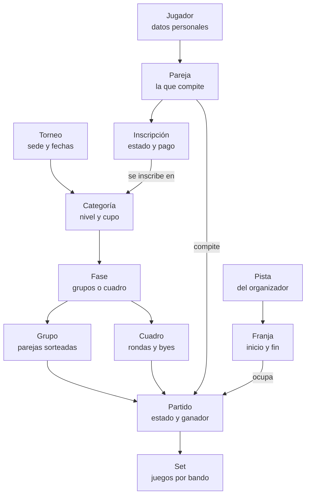
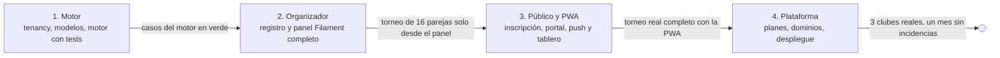

# Briefing funcional: SaaS de torneos de pádel

29 de octubre de 2026 · Pablo

## Objetivo

Construir un SaaS multi-tenant de gestión de torneos, al estilo de Xporty, en el que cualquier organizador se da de alta por sí mismo, crea sus torneos y los publica con inscripción online, cuadros, horarios y resultados en vivo. La v1 cubre a fondo el torneo de pádel por parejas con fase de grupos y fase eliminatoria configurables; el modelo queda preparado para otros deportes y formatos.

El producto se entrega como aplicación web progresiva (PWA) instalable en móvil y escritorio, sin apps nativas en Android ni iOS. El stack es el mismo que el de Club de Exploradores SaaS (CEAS): Laravel 13, Livewire 4, Filament 5, Tailwind 4 y stancl/tenancy.

Tres resultados definen el éxito de la v1:

- Un organizador nuevo pasa del registro a un torneo publicado con inscripciones abiertas en menos de 15 minutos sin ayuda.
- El día del torneo, grupos, cuadros, horarios y resultados se gestionan desde el móvil y el público los ve actualizados en segundos.
- El motor de competición (grupos, clasificación, criterios de desempate, clasificados, cuadro eliminatorio, consolación) está cubierto por tests automáticos y no depende de ninguna interfaz.

## Alcance de la v1

La v1 es un producto usable de punta a punta para torneos de pádel, no una demo del motor.

Dentro:

- Alta self-service de organizadores con subdominio propio, verificación de email y plan gratuito por defecto.
- Creación de torneos con varias categorías, modalidad parejas, fase de grupos y fase eliminatoria con cuadro de consolación opcional.
- Inscripción online pública por pareja, con lista de espera, cupo y cierre de inscripciones.
- Sorteo de grupos (manual, aleatorio o con cabezas de serie), generación de partidos, horarios por pista y franja, y edición manual de todo ello.
- Resultados por sets, clasificación en vivo con criterios de desempate configurables, paso automático a eliminatoria.
- Página pública del torneo y del organizador, pantalla de tablero para televisores, código QR.
- PWA instalable, notificaciones push web y correo transaccional.
- Panel de plataforma para administrar organizadores, planes y límites.
- Exportaciones a PDF (cuadros, horarios, clasificaciones) y CSV (inscritos).

Fuera, previsto para fases posteriores:

- Apps nativas Android o iOS. Todo se sirve como PWA.
- Cobro online de inscripciones y facturación de planes (Stripe). En v1 el pago se marca a mano.
- Ligas por jornadas, circuitos con ranking acumulado y sistema suizo.
- Deportes por equipos con plantillas y convocatorias. El modelo lo contempla, la interfaz no.
- Web personalizada con marca blanca por organizador más allá de logo, colores y dominio propio.
- Chat o mensajería entre participantes.

## Stack técnico

Se parte del mismo stack que CEAS, con las versiones fijadas en su `composer.lock` y `package-lock.json` de octubre de 2026, para reutilizar convenciones, tenancy y notificaciones push ya resueltas.

| Pieza | Elección | Papel en el proyecto |
| --- | --- | --- |
| Lenguaje | PHP 8.4 | Requisito de Laravel 13 y Symfony 8 |
| Framework | Laravel 13 | Núcleo, colas, colas de correo, programador |
| Interfaz dinámica | Livewire 4 | Front público, inscripción, resultados en vivo, tablero |
| Panel | Filament 5 | Panel del organizador (tenant) y panel de plataforma (central) |
| Estilos | Tailwind 4 + Vite | Front público y PWA |
| Multi-tenant | stancl/tenancy 3 | Una base de datos por organizador, resuelta por subdominio o dominio propio |
| Push web | minishlink/web-push | Notificaciones PWA a organizadores y jugadores |
| PDF | dompdf | Cuadros, horarios y clasificaciones imprimibles |
| Tests | Pest 5, Pint, PHPStan (Larastan) | Motor de competición con cobertura total, feature tests del resto |
| Base de datos | SQLite en local y tests, MySQL o PostgreSQL en producción | Igual que CEAS |
| Despliegue | Laravel Cloud o VPS con Forge | Misma pauta que CEAS |

Piezas nuevas respecto a CEAS:

- Manifiesto PWA, service worker con caché de consulta (cuadros, horarios) y página offline. Sin dependencias nuevas: se escribe a mano en `resources/js`.
- Un paquete interno `App\Competicion` (motor de competición) con clases puras, sin Eloquent, que reciben arrays o DTOs y devuelven grupos, partidos, clasificaciones y cuadros.
- Cola obligatoria en producción para envíos push y correo masivo.

Convenciones heredadas de CEAS que se mantienen: código y dominio en español, zona horaria Europa/Madrid, traducciones de Laravel-Lang en `lang/es`, papelera con `deleted_at` en las tablas del tenant, una cuenta por rol en el seeder de pruebas.

## Actores y roles

Hay dos contextos de autenticación separados: la plataforma (base central) y cada organizador (base del tenant). Un jugador se identifica dentro del tenant del organizador; no existe una cuenta global de jugador en v1.

| Actor | Dónde vive | Qué puede hacer |
| --- | --- | --- |
| Administrador de plataforma | Base central, panel `/plataforma` | Ver y gestionar organizadores, planes, límites, suspensiones, métricas, soporte |
| Organizador (propietario) | Tenant, panel `/panel` | Todo sobre su organización: torneos, pistas, equipo, marca, dominio, plan |
| Administrador de torneo | Tenant, panel `/panel` | Gestionar los torneos que se le asignen: inscripciones, sorteo, horarios, resultados. No toca ajustes de la organización ni el plan |
| Árbitro o mesa | Tenant, vista móvil `/mesa` | Introducir y corregir resultados de los partidos asignados a sus pistas, nada más |
| Jugador | Tenant, portal `/jugador` | Inscribirse con su pareja, ver sus partidos y horarios, registrar resultado si el torneo lo permite, validar el del rival, recibir avisos |
| Público | Sin cuenta | Ver torneos publicados, inscritos, grupos, cuadros, horarios, resultados y clasificaciones. Instalar la PWA y suscribirse a push de un torneo |

Reglas de autorización:

- Las policies se definen por recurso del tenant (Torneo, Categoria, Partido, Inscripcion). Un administrador de torneo solo ve los torneos de su tabla pivote `torneo_administrador`.
- El jugador solo ve datos personales (teléfono, email) de su propia pareja. En público solo aparecen nombre y apellidos, o un alias si el organizador activa la opción de privacidad.
- El organizador decide por torneo si los jugadores pueden registrar resultados. Si lo activa, un resultado introducido por un jugador queda en estado pendiente hasta que el rival lo confirma o la organización lo valida.

## Multi-tenancy y alta de organizadores

Cada organizador es un tenant con su propia base de datos, igual que cada club en CEAS. La base central guarda organizadores, dominios, planes, usuarios de plataforma y métricas agregadas.

Resolución por host:

- `app.midominio.com` es la plataforma: landing comercial, registro, acceso al panel de plataforma. No pertenece a ningún tenant.
- `{slug}.midominio.com` resuelve al organizador. El slug se elige en el registro, es único y no se puede cambiar después sin soporte.
- Un dominio propio (`torneos.miclub.es`) se añade desde el panel, se verifica por registro DNS TXT y queda activo en el plan de pago.
- Host desconocido responde 404. En local y testing se admite `localhost` mediante una variable de entorno de hosts de desarrollo, como `CLUBES_HOSTS_DESARROLLO` en CEAS.

Flujo de alta self-service:

1. Formulario público en la plataforma: nombre de la organización, slug deseado con comprobación en vivo, nombre y email del responsable, contraseña, aceptación de condiciones y política de privacidad.
2. Se crea el registro central del organizador en estado pendiente de verificación y se envía el correo de verificación.
3. Al verificar el email, un job crea la base del tenant, ejecuta migraciones y seeders base (tipos de fase por defecto, plantillas de formato de partido) y crea al usuario propietario.
4. Primer acceso al panel con un asistente de tres pasos: logo y colores, pistas disponibles, primer torneo. Cada paso se puede saltar.
5. El organizador queda en plan gratuito con sus límites. Cambiar de plan en v1 lo hace el administrador de plataforma a mano.

Ciclo de vida del organizador: pendiente, activo, suspendido (por impago o abuso; el panel se bloquea y las páginas públicas muestran aviso), dado de baja (se programa el borrado de la base a los 30 días, con exportación previa de sus datos en ZIP).

Cada organizador puede tener varios usuarios en su equipo: el propietario invita por email con rol de administrador de torneo o árbitro, igual que el módulo Equipo de CEAS.

## Modelo de dominio

Todo cuelga del torneo y se ramifica por categoría. Un torneo tiene varias categorías; cada categoría tiene su propia lista de inscritos, sus fases y su clasificación. Las pistas y franjas horarias son del torneo y se reparten entre categorías.



Modelo de dominio: 12 entidades del tenant. Partido y Clasificación apuntan siempre a Pareja, nunca a Jugador; una franja de pista aloja como máximo un partido.

Entidades del tenant (tablas de la base del organizador):

| Entidad | Campos clave | Relaciones |
| --- | --- | --- |
| Organizacion | nombre, slug, logo, colores, dominio propio, zona horaria, textos legales | Tiene Usuarios, Pistas, Torneos |
| Usuario | nombre, email, rol (propietario, admin, arbitro) | Administra Torneos (pivote), Mesa de Pistas |
| Torneo | nombre, deporte, sede, fechas, estado (borrador, inscripcion, sorteo, en juego, finalizado, archivado), publico, permite resultados por jugadores, textos de normativa | Tiene Categorias, Pistas asignadas, Franjas, Inscripciones |
| Categoria | nombre, modalidad (individual, parejas, equipos), genero, nivel, cupo, precio informativo, orden | Tiene Inscripciones, Fases, Formato de partido por defecto |
| Jugador | nombre, apellidos, email, telefono, fecha nacimiento, genero, nivel declarado, alias publico | Participa en Parejas, tiene Disponibilidades |
| Pareja (Participante) | nombre visible, categoria, cabeza de serie, estado | Dos Jugadores; una Inscripcion |
| Inscripcion | categoria, participante, estado (pendiente, confirmada, lista de espera, baja), pago marcado, notas, origen | Pertenece a Categoria y Participante |
| Fase | categoria, tipo (grupos, eliminatoria, consolacion, liga), orden, configuracion JSON, estado | Tiene Grupos o Cuadro, Partidos, Reglas de clasificados |
| Grupo | fase, nombre, orden | Tiene Participantes (pivote con posicion de sorteo) y Partidos |
| Partido | fase, grupo o posicion de cuadro, ronda, participante local y visitante, pista, franja, estado (pendiente, programado, en juego, jugado, walkover, anulado), ganador | Tiene Sets, Resultado pendiente de validacion |
| Set | partido, numero, juegos local, juegos visitante, tie-break | Pertenece a Partido |
| FormatoPartido | nombre, numero de sets, juegos por set, tie-break, super tie-break final, punto de oro, duracion estimada | Reutilizable entre categorias y fases |
| Pista | nombre, sede, orden, activa | Tiene Franjas y Partidos |
| Franja | torneo, pista, inicio, fin | Un Partido como maximo |
| Disponibilidad | jugador, torneo, intervalo no disponible | Restringe el planificador |
| Clasificacion | fase, grupo, participante, puntos, PJ, PG, PP, sets a favor y en contra, juegos a favor y en contra, posicion, desempate aplicado | Materializada, se recalcula al cerrar cada partido |
| SuscripcionPush | endpoint, claves, usuario o anonimo, torneos seguidos | Reutiliza el modulo Push de CEAS |

Entidades de la base central: Organizador (tenant), Dominio, Plan, SuscripcionPlan, UsuarioPlataforma, EventoUso (contadores para límites), Auditoria global.

Decisiones de modelado:

- Participante es la entidad que compite. En pádel es una Pareja de dos Jugadores; en el futuro será un Equipo o un Jugador individual. Partido y Clasificación siempre apuntan a Participante, nunca a Jugador.
- La configuración de cada Fase se guarda en JSON validado por un DTO tipado. Así se añaden formatos sin migraciones.
- Un Partido de eliminatoria guarda ronda y posición en el cuadro; sus participantes pueden ser nulos hasta que el partido anterior o la fase de grupos se cierre. Guarda también de dónde vienen (ganador del partido X, primero del grupo A).

## Configuración del torneo de pádel

El organizador configura cada categoría por separado; las opciones de abajo se aplican por categoría y, cuando tiene sentido, por fase. Todo lo que el sistema calcula se puede corregir a mano después (mover una pareja de grupo, cambiar un cruce, reprogramar un partido), y cada corrección queda en la auditoría.

### Torneo

- Datos: nombre, sede y dirección, fechas de juego (uno o varios días), fechas de apertura y cierre de inscripción, cartel, normativa en texto libre, contacto.
- Visibilidad: borrador, publicado en la web del organizador, listado en el buscador de la plataforma.
- Resultados por jugadores: desactivado, activado con validación del rival, activado sin validación.
- Privacidad: mostrar nombre completo o alias en público.

### Categorías

- Varias por torneo: por ejemplo Masculina 3ª, Femenina 4ª, Mixta B. Cada una con nombre, género (masculino, femenino, mixto, abierto), nivel, cupo máximo de parejas, mínimo para celebrarse y precio informativo.
- Un jugador puede inscribirse en más de una categoría. El planificador evita solapar sus partidos.
- Formato de partido por defecto de la categoría, que cada fase puede sobrescribir.

### Formato de partido

| Opción | Valores | Por defecto |
| --- | --- | --- |
| Número de sets | Un set, al mejor de 3, al mejor de 5 | Al mejor de 3 |
| Juegos por set | 4, 6 o 9 (set largo) | 6 |
| Diferencia para ganar el set | 1 o 2 juegos | 2 |
| Tie-break | Al llegar a 6-6 (o 4-4, 8-8), sin tie-break | Sí, a 7 puntos |
| Super tie-break en el set decisivo | Sí (a 10 puntos) o no | No |
| Punto de oro | Sí o no (informativo, no afecta al cálculo) | Sí |
| Partido por tiempo | Minutos fijos; al acabar gana quien va delante en juegos | Desactivado |
| Duración estimada | Minutos, para el planificador | 60 en grupos, 75 en eliminatoria |

El formato se guarda como plantilla reutilizable con nombre (por ejemplo "Americano 1 set a 6 con tie-break").

### Fase de grupos

- Reparto de grupos: por número de grupos o por tamaño de grupo (3, 4, 5 parejas). El sistema propone el reparto más equilibrado y avisa si quedan grupos de distinto tamaño.
- Sorteo: aleatorio, por cabezas de serie (las N primeras marcadas se reparten una por grupo, serpiente), o manual arrastrando parejas. Se puede resortear mientras no haya resultados.
- Partidos por pareja: todos contra todos (n-1 partidos), o un número fijo menor (por ejemplo 2 partidos en grupos de 4). Con número fijo el sistema reparte los cruces para que todas las parejas jueguen lo mismo y avisa si el número no es alcanzable.
- Ida y vuelta: opcional para torneos de varias semanas.
- Puntuación: puntos por victoria, derrota, walkover a favor y en contra, y por partido no jugado. Por defecto 2, 0, 2, 0 y 0. Opción de puntos por set ganado para formatos a un set.
- Criterios de desempate, ordenables: puntos, enfrentamiento directo (solo entre dos empatadas), diferencia de sets, sets ganados, diferencia de juegos, juegos ganados, sorteo. Con tres o más empatadas se aplica la mini-clasificación entre ellas antes de ir al siguiente criterio.
- Formato de partido propio de la fase, opcional.

### Quién pasa a la eliminatoria

- Clasificados por grupo: los N primeros de cada grupo (1, 2, 3…).
- Mejores terceros o mejores segundos: añadir los M mejores de una posición concreta comparando por los mismos criterios de desempate, con ajuste cuando los grupos son de distinto tamaño (se descarta el resultado contra el último del grupo grande).
- Resultado: el sistema muestra la lista de clasificados y el número total, y propone el tamaño de cuadro (8, 16, 32) con los byes necesarios.
- Consolación: opcional. Las parejas no clasificadas pasan a un cuadro de consolación, o los perdedores de la primera ronda del cuadro principal, a elección del organizador.
- Sin fase de grupos: el torneo puede ser solo cuadro eliminatorio directo, con sorteo o cabezas de serie.

### Fase eliminatoria

- Cuadro simple con byes para la cabeza de serie cuando el número de clasificados no es potencia de 2.
- Emparejamientos: regla de cruces entre grupos (1º del A contra 2º del B, etc.), evitando reencuentros de la fase de grupos en la primera ronda cuando sea posible, o sorteo puro, o cruces manuales.
- Partido por el tercer y cuarto puesto, opcional.
- Formato de partido propio por ronda: por ejemplo un set en octavos y al mejor de 3 desde semifinales.
- Doble eliminación queda fuera de la v1.

### Horarios y pistas

- Pistas del torneo, seleccionadas entre las de la organización, con días y horas de disponibilidad por pista.
- Franjas generadas a partir de la duración estimada del formato, con margen entre partidos configurable (0, 5, 10 minutos).
- Restricciones: descanso mínimo entre partidos de una misma pareja, no solapar categorías de un mismo jugador, disponibilidades que los jugadores indican al inscribirse, orden de prioridad entre categorías.
- El planificador asigna automáticamente y el organizador reordena arrastrando partidos entre franjas y pistas en una parrilla. Los conflictos se marcan, no se bloquean.
- Publicación de horarios: hasta publicar, los jugadores no reciben nada; al publicar se envía el aviso.

### Resultados

- Introducción por sets con validación contra el formato (un set a 6 no admite 7-3). Walkover, retirada y no presentado como estados especiales con sus puntos.
- Estados del partido: pendiente, programado, en juego, jugado, pendiente de validación, walkover, anulado.
- Al guardar un resultado se recalcula la clasificación del grupo y, si la fase está completa, se ofrece cerrar fase y rellenar el cuadro.

## Motor de competición

El motor vive en `app/Competicion` como clases puras sin Eloquent ni sesión. Recibe DTOs y devuelve DTOs, y es la parte con más tests del proyecto. Los modelos y los componentes Livewire solo lo llaman y persisten lo que devuelve.

| Servicio | Entrada | Salida | Reglas que debe cumplir |
| --- | --- | --- | --- |
| RepartidorDeGrupos | participantes con cabeza de serie, número o tamaño de grupo, modo de sorteo, semilla | grupos con sus participantes | Tamaños equilibrados, cabezas de serie en serpiente, determinista con semilla para poder repetir el sorteo |
| GeneradorRoundRobin | participantes de un grupo, partidos por pareja, ida y vuelta | lista de partidos con orden de jornada | Algoritmo de círculo para todos contra todos; con número fijo reparte cruces sin repetir y con igual carga; marca descansos |
| CalculadorDeClasificacion | partidos jugados, puntuación, criterios de desempate ordenados | tabla ordenada con posición y criterio aplicado en cada corte | Mini-liga entre empatadas con tres o más, enfrentamiento directo solo con dos, sorteo registrado para que no cambie entre recálculos |
| SelectorDeClasificados | clasificaciones de todos los grupos, regla de clasificados | lista ordenada de clasificados con su origen | Mejores terceros con ajuste por grupos de distinto tamaño |
| ConstructorDeCuadro | clasificados ordenados, tamaño de cuadro, regla de cruces, evitar reencuentros | partidos de todas las rondas con origen de cada hueco | Byes a los mejores clasificados, cabezas de serie en extremos opuestos, cruces entre grupos distintos cuando sea posible |
| ConstructorDeConsolacion | perdedores de primera ronda o no clasificados | cuadro de consolación | Mismas reglas que el cuadro principal |
| AvanceDeCuadro | partido cerrado con ganador | siguiente partido actualizado | Idempotente: cerrar dos veces no duplica; anular un resultado vacía el hueco siguiente si aún no se jugó |
| ValidadorDeResultado | sets introducidos, formato de partido | válido o lista de errores, ganador | Juegos por set, diferencia, tie-break, super tie-break, partidos por tiempo |
| Planificador | partidos pendientes, pistas y franjas, duraciones, restricciones | asignación partido-franja-pista y lista de conflictos | Heurística voraz con prioridad por categoría y ronda; nunca falla, devuelve conflictos para que el organizador decida |

Reglas transversales:

- Toda operación que cambie grupos, cuadros u horarios se ejecuta en una transacción y registra un evento de auditoría con usuario, antes y después.
- Resortear o regenerar está bloqueado si la fase tiene algún partido jugado, salvo confirmación explícita que anula los resultados.
- La clasificación se materializa en tabla para que las páginas públicas no recalculen en cada visita; se recalcula en el mismo request al guardar un resultado.
- El motor no conoce el deporte. Las reglas de pádel entran por el FormatoPartido y por la puntuación de la fase, de modo que tenis o fútbol sala se añaden con otro formato.

Casos de prueba mínimos que el motor debe superar antes de tocar interfaz: grupos de 3, 4 y 5 con todos contra todos; grupo de 4 con 2 partidos por pareja; triple empate resuelto por diferencia de sets; mejores terceros con grupos de 4 y 5; cuadro de 12 clasificados en cuadro de 16 con 4 byes; consolación de perdedores de primera ronda; anulación de un resultado que ya había avanzado al siguiente partido; planificación con un jugador en dos categorías.

## Flujos de usuario

El torneo avanza por estados y cada estado abre un conjunto de acciones. El organizador siempre puede volver un paso atrás con confirmación, salvo desde finalizado.

```mermaid
stateDiagram-v2
    direction LR
    Borrador: Borrador (al crear el torneo)
    Abierta: Inscripción abierta (organizador o fecha)
    Cerrada: Inscripción cerrada (organizador o fecha)
    Sorteo: Sorteo (organizador)
    EnJuego: En juego (horarios publicados)
    Finalizado: Finalizado (tras la final)
    Archivado: Archivado (sistema, 90 días)

    [*] --> Borrador
    Borrador --> Abierta: publica
    Abierta --> Cerrada: cierra el plazo
    Cerrada --> Sorteo: sortea y planifica
    Sorteo --> EnJuego: publica horarios
    EnJuego --> Finalizado: confirma tras la final
    Finalizado --> Archivado: a los 90 días
    Sorteo --> Cerrada: vuelve un paso atrás, con confirmación
    Cerrada --> Abierta: vuelve un paso atrás, con confirmación
    EnJuego --> Sorteo: vuelve un paso atrás, con confirmación
```



Estados del torneo: 7 estados, 1 vuelta atrás. Las fechas de apertura y cierre mueven el torneo solas; el resto de transiciones las dispara el organizador y quedan en la auditoría.

### Organizador: del alta al torneo publicado

1. Se registra en la plataforma, verifica el email y entra en su panel.
2. Completa logo, colores y pistas en el asistente inicial.
3. Crea un torneo con el asistente de cuatro pasos: datos generales, categorías, formato de partido y fases, inscripción (fechas, cupo, campos extra, precio informativo).
4. Previsualiza la página pública y publica. El torneo pasa a inscripción abierta en la fecha indicada.
5. Comparte el enlace y el QR del torneo por WhatsApp o redes.

### Jugador: inscripción

1. Abre la página del torneo, elige categoría y pulsa inscribirse.
2. Crea cuenta ligera (nombre, email, teléfono) o entra si ya existe en ese organizador. Enlace mágico por email como alternativa a contraseña.
3. Indica su pareja: busca un jugador ya registrado o escribe nombre y teléfono de su compañero, que recibe una invitación para confirmar.
4. Marca franjas en las que no puede jugar, si el torneo lo pide.
5. Recibe confirmación por email y push. Si no hay cupo, entra en lista de espera y se le avisa cuando se libera plaza.
6. Puede darse de baja hasta el cierre de inscripciones; después solo lo hace la organización.

### Organizador: cierre y sorteo

1. Cierra inscripciones a mano o por fecha. Revisa la lista, confirma pagos marcados, mueve parejas de lista de espera, da de baja a quien no responde.
2. Marca cabezas de serie y lanza el sorteo de grupos. Ajusta a mano si hace falta.
3. Genera partidos y lanza el planificador. Revisa la parrilla, corrige conflictos y publica horarios. Todos los inscritos reciben aviso con sus partidos.

### Día de juego

1. El organizador o la mesa abre la vista de pista en el móvil: lista de partidos de esa pista en orden, con botón de introducir resultado.
2. Al guardar un resultado la clasificación del grupo se actualiza y la página pública y el tablero se refrescan.
3. Si el torneo permite resultados por jugadores, un jugador de la pareja introduce el marcador y la pareja rival recibe push para validarlo; sin respuesta en el tiempo configurado (por defecto 30 minutos) se da por válido o lo cierra la organización.
4. Al completarse la fase de grupos el sistema muestra los clasificados y el organizador confirma el paso al cuadro. Los cruces de primera ronda se planifican en las franjas libres.
5. Las rondas avanzan conforme se cierran partidos. Final y tercer puesto cierran el torneo.

### Cierre

1. El organizador marca el torneo como finalizado. Se congela la clasificación final por categoría y se envía el aviso de resultados a los inscritos.
2. Puede exportar en PDF cuadros y clasificaciones, y en CSV la lista de inscritos.
3. Pasados 90 días el torneo se archiva y deja de aparecer en la portada del organizador, pero sigue accesible por su enlace.

## Páginas públicas y panel del organizador

El front público y el portal del jugador se construyen en Livewire con Tailwind, pensados primero para móvil. El panel del organizador y el de plataforma se construyen en Filament.

### Páginas públicas del tenant

| Ruta | Contenido |
| --- | --- |
| `/` | Portada del organizador: logo, torneos abiertos a inscripción, en juego y recientes |
| `/torneos/{slug}` | Ficha del torneo: datos, normativa, categorías con plazas libres, botón de inscripción, pestañas de inscritos, grupos, cuadro, horarios y clasificación |
| `/torneos/{slug}/inscripcion` | Flujo de inscripción por pasos |
| `/torneos/{slug}/tablero` | Tablero a pantalla completa para televisores: rota entre pistas en juego, próximos partidos y clasificaciones, se refresca solo |
| `/torneos/{slug}/pista/{n}` | Partidos del día en una pista, para colgar como QR en la propia pista |
| `/jugador` | Portal del jugador: mis inscripciones, mis partidos con hora y pista, registrar o validar resultado, mis datos, notificaciones |
| `/mesa` | Vista de árbitro o mesa: partidos de sus pistas e introducción rápida de resultados |

Las páginas de torneo se actualizan por polling de Livewire cada 15 segundos mientras el torneo está en juego, y cada 5 segundos en el tablero. No se usa WebSockets en v1.

### Panel del organizador (Filament, `/panel`)

- Torneos: listado con estado, acciones de publicar, cerrar inscripciones, sortear, planificar, finalizar, duplicar. Editor con pestañas de datos, categorías, fases, inscripción, pistas y horarios.
- Inscripciones: tabla filtrable por categoría y estado, marcar pago, mover a lista de espera, dar de baja, inscribir a mano, importar CSV, exportar.
- Sorteo y grupos: vista de grupos con arrastrar y soltar, marcar cabezas de serie, resortear.
- Horarios: parrilla pistas por franjas con arrastrar y soltar, lista de conflictos, publicar.
- Resultados: tabla de partidos con introducción por sets, pendientes de validación, anular.
- Cuadro: vista de árbol con edición de cruces antes de empezar la ronda.
- Jugadores: base de jugadores del organizador con historial de torneos y fusión de duplicados.
- Pistas y sedes.
- Plantillas: formatos de partido y configuraciones de fase guardadas.
- Comunicaciones: enviar aviso push y email a todos los inscritos de un torneo o categoría.
- Equipo: invitar administradores y árbitros, asignar torneos y pistas.
- Ajustes: marca, dominio propio, textos legales, plan actual y límites.

Patrones de interfaz heredados de CEAS: clusters de Filament por área, color del panel por organizador, widgets de resumen en el escritorio (inscripciones de hoy, partidos pendientes, próximos torneos), papelera con restaurar.

## PWA y notificaciones

La PWA sustituye a las apps nativas de Xporty. Cada tenant sirve su propio manifiesto con nombre, logo y color del organizador, de modo que al instalarla en el móvil el jugador ve el icono del club, no el de la plataforma.

Requisitos de la PWA:

- Manifiesto dinámico por tenant (`/manifest.webmanifest`), iconos generados a partir del logo en 192 y 512 píxeles, `display: standalone`, `start_url` en la portada del organizador.
- Service worker con estrategia de red primero y caché de respaldo para las páginas de torneo, cuadros y horarios; estrategia de caché primero para iconos y recursos compilados por Vite. Página offline propia que muestra lo último cacheado con la hora de la última actualización.
- Aviso de instalación discreto en la ficha del torneo tras la inscripción, con instrucciones para iOS (compartir, añadir a inicio), ya que Safari no muestra el aviso automático.
- Las acciones de escritura (inscribirse, registrar resultado) exigen conexión; el service worker no encola escrituras en v1.
- Auditoría con Lighthouse en integración continua: PWA instalable y rendimiento móvil por encima de 80.

Notificaciones push web, reutilizando el módulo Push de CEAS (`minishlink/web-push`, claves VAPID por plataforma):

| Evento | Destinatario | Canal |
| --- | --- | --- |
| Inscripción recibida y confirmada | Los dos jugadores de la pareja | Email y push |
| Plaza liberada desde lista de espera | Pareja en espera | Email y push |
| Invitación de compañero de pareja | Jugador invitado | Email, SMS fuera de alcance |
| Horarios publicados o modificados | Inscritos afectados | Push y email |
| Próximo partido en 30 minutos | Las dos parejas | Push |
| Resultado registrado por el rival, pendiente de validar | Pareja rival | Push |
| Resultado del partido y nueva clasificación | Las dos parejas y seguidores del torneo | Push |
| Paso a eliminatoria y cruce asignado | Clasificados | Push y email |
| Aviso libre de la organización | Inscritos del torneo o categoría | Push y email |
| Nuevo torneo publicado | Jugadores que siguen al organizador | Push |

Reglas: el público puede seguir un torneo sin cuenta y recibir solo resultados y horarios. El jugador elige qué avisos recibe desde su portal. Los envíos salen por cola y se agrupan: cuando se publican horarios no se envía un push por partido sino uno por jugador. Las notificaciones de Laravel se escriben una vez con canales mail, push y base de datos para que el portal muestre el historial.

## Panel de plataforma, planes y límites

El panel central (`/plataforma`, Filament en la base central) lo usa solo el equipo de la plataforma. Su primera versión es pequeña: organizadores, planes y soporte.

Funciones del panel de plataforma:

- Organizadores: listado con estado, plan, torneos activos, inscritos del mes, último acceso. Acciones de activar, suspender, cambiar plan, entrar como propietario (impersonación con registro en auditoría) y programar baja.
- Dominios: verificar dominios propios, ver estado del certificado.
- Planes: definir planes con sus límites y precios informativos.
- Métricas: organizadores nuevos por semana, torneos publicados, inscripciones, push enviados, en un panel de widgets.
- Registro de errores con el visor de logs ya usado en CEAS.

Planes propuestos, inspirados en el modelo de Xporty pero con cuota mensual en lugar de pago por competición, porque simplifica la implementación y el soporte. Los precios son orientativos y se fijan antes del lanzamiento.

| Plan | Precio orientativo | Torneos activos | Parejas por torneo | Categorías por torneo | Extras |
| --- | --- | --- | --- | --- | --- |
| Gratis | 0 € | 1 | 16 | 2 | Marca de la plataforma en el pie |
| Club | 19 € al mes | 3 | 64 | 6 | Sin marca, push ilimitado, exportaciones |
| Organizador | 49 € al mes | Ilimitados | 200 | Ilimitadas | Dominio propio, varios administradores, prioridad de soporte |

Aplicación de límites: se comprueban al publicar un torneo y al confirmar una inscripción, nunca al guardar borradores. Al llegar al límite el panel explica qué plan lo desbloquea y la inscripción pública muestra cupo completo. Los contadores se guardan en la base central mediante eventos de uso para que el panel de plataforma no tenga que consultar cada tenant.

Cobro en v1: el administrador de plataforma cambia el plan a mano tras el pago por transferencia o enlace de pago externo. La integración con Stripe Billing es la primera tarea de la fase 2.

## Requisitos no funcionales

- Idioma y zona: interfaz en español, código y nombres de dominio en español siguiendo la convención de CEAS, hora de Madrid por defecto y zona horaria configurable por organizador. Las cadenas pasan por `__()` desde el principio para poder añadir inglés y portugués después.
- Protección de datos: consentimiento explícito en el registro de jugador, textos legales por organizador, derecho de supresión desde el portal del jugador (anonimización que conserva los resultados), exportación de datos del organizador en ZIP al darse de baja. Datos de menores: fecha de nacimiento opcional y aviso de autorización de tutor si es menor de 14 años.
- Seguridad: políticas en todos los recursos, límite de peticiones en registro, inscripción y resultados por jugador, enlaces mágicos de un solo uso con caducidad de 15 minutos, cabeceras de seguridad, aislamiento total entre tenants verificado con tests.
- Rendimiento: página de torneo por debajo de 300 ms en servidor con 200 parejas y 400 partidos; clasificaciones materializadas; consultas con carga anticipada y sin N+1, comprobado con tests que cuentan consultas.
- Fiabilidad: colas con reintentos para push y email, jobs idempotentes, copias de seguridad diarias de cada base de tenant, auditoría de cambios en sorteo, cuadros, horarios y resultados.
- Accesibilidad: contraste AA en los colores del organizador (el panel avisa si el color elegido no cumple), navegación por teclado en los formularios, tamaño mínimo de toque de 44 píxeles en las vistas de pista.
- Calidad: Pint, PHPStan nivel 6 o superior y Pest en integración continua; cobertura total del motor de competición; feature tests de cada flujo descrito en este documento; seeder con un organizador de pruebas y un torneo en cada estado, con cuentas por rol como en CEAS.
- Observabilidad: visor de logs, registro de errores con contexto de tenant, métricas de uso en la base central.

## Roadmap y criterios de aceptación

El trabajo se ordena en cuatro fases. Cada fase termina con una puerta clara, y no se empieza la siguiente sin superarla. La fase 1 no tiene interfaz: solo motor y tests.



Roadmap: 4 fases con su puerta de salida. Los rombos son las puertas: no se abre una fase hasta cumplir la de la anterior.

| Fase | Entrega | Puerta de salida |
| --- | --- | --- |
| 1. Cimientos y motor | Repositorio con el stack, tenancy central y por organizador, modelos y migraciones, motor de competición completo con tests, seeder de pruebas | Todos los casos de prueba del motor en verde; un tenant se crea y se destruye por comando |
| 2. Organizador | Registro self-service, panel Filament con torneos, categorías, fases, inscripciones manuales, sorteo, horarios, resultados y cuadro; exportaciones PDF y CSV | Un organizador crea y juega un torneo completo de 16 parejas solo desde el panel |
| 3. Público y jugador | Páginas públicas, inscripción online con pareja e invitación, portal del jugador, resultados por jugadores con validación, PWA instalable, push y correo, tablero y QR | Un torneo real con inscripción abierta al público se celebra de principio a fin con la PWA |
| 4. Plataforma y lanzamiento | Panel de plataforma, planes y límites, dominios propios, baja y exportación de datos, textos legales, Lighthouse en CI, despliegue | Tres organizadores reales en producción durante un mes sin incidencias bloqueantes |

Criterios de aceptación del MVP (final de la fase 3):

- [ ] Un organizador nuevo publica un torneo con dos categorías en menos de 15 minutos sin documentación.
- [ ] Una pareja se inscribe desde el móvil, el compañero confirma por email y ambos reciben push de confirmación.
- [ ] Con 20 parejas en grupos de 4 y 2 partidos por pareja el sistema genera 20 partidos, los planifica en 4 pistas sin solapar jugadores y publica horarios.
- [ ] Tras introducir todos los resultados de grupos, un triple empate se resuelve con los criterios configurados y la lista de clasificados coincide con el cálculo manual.
- [ ] El cuadro de 8 con 2 mejores terceros se rellena solo, los cruces evitan reencuentros de grupo y la consolación recoge a los no clasificados.
- [ ] Un resultado introducido por un jugador queda pendiente hasta que el rival lo valida, y el tablero lo muestra en menos de 10 segundos.
- [ ] Anular un resultado ya avanzado revierte el cuadro sin dejar huecos inconsistentes.
- [ ] La PWA se instala en Android e iOS con el icono del organizador y muestra el último cuadro sin conexión.
- [ ] Ningún dato de un organizador es accesible desde el host de otro, verificado por test.
- [ ] Pint, PHPStan y Pest pasan en CI con el motor al 100 % de cobertura.

## Supuestos y decisiones abiertas

Supuestos tomados en este briefing, que se pueden cambiar antes de empezar:

- Cobro: no hay pasarela de pago en v1. El organizador marca el pago a mano y la plataforma cobra los planes fuera del sistema.
- Cuenta de jugador por organizador, no global. Un jugador que participa en torneos de dos organizadores tiene dos cuentas. Unificarlas es un cambio de fase 2 que el modelo permite si Jugador guarda un identificador de plataforma opcional.
- Un torneo es de un solo deporte. Las categorías comparten deporte y difieren en nivel y género.
- El tiempo real se resuelve con polling de Livewire, no con WebSockets ni Reverb.
- La doble eliminación, el sistema suizo y las ligas por jornadas no entran en v1 aunque el modelo de Fase los admite.
- El planificador es una heurística que devuelve conflictos, no un optimizador exacto.

Decisiones abiertas que conviene cerrar en el primer chat de implementación:

- [ ] Nombre del producto y dominio de la plataforma.
- [ ] Base de datos de producción: MySQL o PostgreSQL. CEAS usa SQLite en local; la producción no está fijada en este documento.
- [ ] Despliegue en Laravel Cloud o en VPS propio, y cómo se provisionan los subdominios comodín y certificados para dominios propios.
- [ ] Proveedor de correo transaccional (Resend, Postmark, SES).
- [ ] Si el plan gratuito muestra publicidad o solo la marca de la plataforma.
- [ ] Si el jugador inscribe a su pareja sin que esta confirme (más rápido) o con confirmación (más limpio). El briefing asume confirmación con plazo de 48 horas y aviso al organizador si no llega.
- [ ] Si el público ve teléfonos o emails en algún caso. El briefing asume que nunca.

## Cómo arrancar el nuevo repositorio en otro chat de Claude

Exporta este documento a Markdown y guárdalo como `docs/briefing.md` en el repositorio nuevo. Crea el repositorio vacío en GitHub, añádelo a la sesión de Claude Code junto con `ismaeloku7/clubexploradoressaas` como referencia de convenciones, y abre el chat con un mensaje como este:

```text
Lee docs/briefing.md. Es el briefing funcional de un SaaS de torneos de pádel.
Usa el mismo stack y las mismas convenciones que el repositorio clubexploradoressaas
(Laravel 13, Livewire 4, Filament 5, Tailwind 4, stancl/tenancy, Pest, Pint, PHPStan,
código en español, hora de Madrid, papelera, seeder con cuentas por rol).

Empieza por la fase 1 del roadmap: crea el proyecto Laravel, configura tenancy
central y por organizador, define modelos y migraciones del modelo de dominio,
e implementa el motor de competición en app/Competicion con todos los casos de
prueba listados en la sección "Motor de competición". No hagas interfaz todavía.

Antes de escribir código propón el esquema de tablas y la lista de clases del motor
para que lo revise. Después trabaja por commits pequeños y ejecuta Pint, PHPStan y
Pest antes de cada push.
```

Orden recomendado de tareas dentro de la fase 1, para que el otro chat las convierta en issues:

1. Proyecto base con el starter Livewire, Filament 5, tenancy, Pest, Pint, PHPStan, CI de GitHub Actions y `CLAUDE.md` heredado de CEAS.
2. Base central: organizadores, dominios, planes, usuarios de plataforma. Comando para crear y destruir un tenant.
3. Migraciones del tenant según la sección de modelo de dominio, con factories y un seeder de un torneo de 16 parejas.
4. DTOs de configuración de fase y de formato de partido, con validación.
5. Motor: ValidadorDeResultado, CalculadorDeClasificacion, RepartidorDeGrupos, GeneradorRoundRobin, SelectorDeClasificados, ConstructorDeCuadro, ConstructorDeConsolacion, AvanceDeCuadro, Planificador, en ese orden, cada uno con sus tests.
6. Acciones de aplicación que unen motor y modelos: SortearGrupos, GenerarPartidos, PlanificarHorarios, RegistrarResultado, CerrarFase, con tests de feature sobre el seeder.

Al cerrar cada fase, vuelve a este documento, marca sus criterios y anota lo que cambió respecto al briefing.
